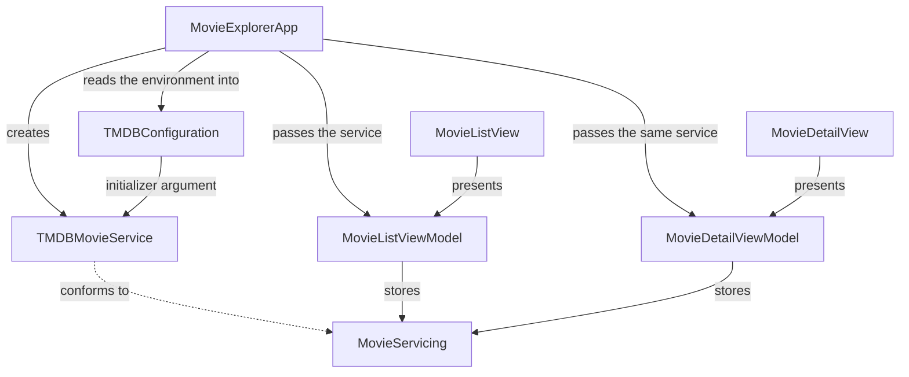

# Dependency Injection in Swift — Part 1: Constructor Injection

Movie Explorer has two screens. One lists popular movies. The other shows the poster, title, overview, and release date. Both need data from TMDB.

On the first afternoon the obvious code works. The list view model builds a client, the simulator shows posters, and you move on. The next task is where it snags. A unit test should not hit the network. The detail screen should use the same client. A SwiftUI preview should run without an API token. None of those is a small edit if the view model is the thing that creates the client.

This is the first part of a series on dependency injection in iOS. The sample is Swift 6, SwiftUI, and MVVM, using `URLSession` and `async`/`await`. There is no cache, search, or paging. The project beside this article is the finished design. This part is about one choice: pass a required collaborator into an initializer. Setter injection and method injection come later. A container is not part of the technique.

## Why the first version hurts

Here is the list view model as it tends to get written. The initializer looks empty. It is not. `load()` is the same method throughout the refactor, and the repository contains the finished version, not this one.

```swift
@MainActor
@Observable
final class MovieListViewModel {
    private let movieService: TMDBMovieService

    init() {
        movieService = TMDBMovieService(
            configuration: TMDBConfiguration.loadFromEnvironment()
        )
    }
}
```

With the stored state and `load()` from the finished type, this compiles and the app runs. Creating the view model does not open a socket. `load()` does, or it fails because the process has no token.

`MovieListViewModel()` says the type needs nothing. Calling it reads `TMDB_ACCESS_TOKEN` and builds a TMDB client. The work is real. The signature hides it.

The stored type is `TMDBMovieService`. A preview, a fixture, or a staging host means editing the view model. Publishing movies and a readable error does not require the view model to know which host the movies came from.

A test that constructs the view model gets the production client, so the success path depends on TMDB. That is an integration test with a unit-test name.

If the detail screen also calls `TMDBMovieService(configuration:)`, the token and the base URL are chosen twice.

The view model is doing two jobs: choosing a client, and turning that client's result into screen state. Those jobs change for different reasons. That knot is tight coupling. You cannot understand, test, or reuse the view model without the concrete client it builds.

## What dependency injection means

A dependency is another object this object needs in order to do its job. In the tiny type below, `MovieBrowser` needs something that returns titles. The client is the dependency. The browser is not a dependency of the client. The early listings share this `MovieClient`. They are a sketch. Movie Explorer's real types come after.

```swift
struct MovieClient {
    func popularTitles() -> [String] {
        ["Paper Planets"]
    }
}

final class MovieBrowser {
    private let client = MovieClient()

    func titles() -> [String] {
        client.popularTitles()
    }
}
```

Injection means the dependency arrives from outside. The browser stops choosing it:

```swift
final class MovieBrowser {
    private let client: MovieClient

    init(client: MovieClient) {
        self.client = client
    }

    func titles() -> [String] {
        client.popularTitles()
    }
}
```

Dependency injection is that technique, used on purpose. The object that calls a collaborator is no longer the object that constructs it. A test can pass a client that returns `["Paper Planets"]`. A preview can pass one that returns `[]`. The app can pass one that calls TMDB. `titles()` stays the same.

This is not a package, a base class, or a third-party framework. An initializer that takes what the type needs is already the technique.

It is also a small inversion of control. The first browser decides which client exists. The second leaves that decision to the caller. Control over assembly moved outward. SwiftUI calling `body` is a larger version of the same reversal: the framework calls you. Inversion of control is the general idea. Dependency injection is the specific case where the reversed decision is who supplies a collaborator. Martin Fowler pushed for the specific name because "inversion of control" covers too many reversals to tell you what to do.

Keep that separate from the dependency inversion principle. Robert C. Martin's principle is about direction. High-level policy, such as "show popular movies," should not depend on a low-level detail, such as TMDB's JSON. Both should depend on an abstraction. Injection is about assembly. Someone outside supplies the collaborator. You can follow either rule without the other.

This browser names an abstraction and still builds the concrete client. A caller cannot pass a fake. Nothing was injected.

```swift
protocol MovieFetching {
    func popularTitles() -> [String]
}

struct TMDBClient: MovieFetching {
    func popularTitles() -> [String] { ["Paper Planets"] }
}

final class MovieBrowser {
    private let client: any MovieFetching = TMDBClient()
}
```

This one injects a concrete type. The caller supplies it, and the browser still names TMDB. That is injection without dependency inversion.

```swift
struct TMDBClient {
    func popularTitles() -> [String] { ["Paper Planets"] }
}

final class MovieBrowser {
    private let client: TMDBClient

    init(client: TMDBClient) {
        self.client = client
    }
}
```

Movie Explorer does both, for different reasons. The initializer is the injection. `MovieServicing` is the abstraction, added because a second implementation had to be passed in. The protocol is not what makes it injection.

## Three places to pass it

You can hand a collaborator over in three places. Movie Explorer uses the first. The other two are here so you can see why, and later articles take them up properly.

**Constructor injection.** The browser that takes `MovieClient` in `init` is this form. A required collaborator can be a `let`, and `MovieBrowser()` does not compile. That refusal is compile-time. It says nothing about whether `titles()` succeeds when the app runs.

**Setter injection.** The object is created first. The dependency is assigned later. Use it when the collaborator does not exist yet, or when a framework creates the object and you do not own `init`. The object can also be used before it is ready. Here a missing client becomes an empty list. The screen looks fine. The failure is quiet.

```swift
final class MovieBrowser {
    var client: MovieClient?

    func titles() -> [String] {
        client?.popularTitles() ?? []
    }
}

let browser = MovieBrowser()
browser.titles()          // []
browser.client = MovieClient()
browser.titles()          // ["Paper Planets"]
```

Someone has to remember the order. The compiler will not.

**Method injection.** The dependency is a parameter of the operation, and the object does not keep it. That fits a collaborator used for one call. A screen that loads on appear, on retry, and after a failed request would pass the client at every one of those sites.

```swift
final class MovieBrowser {
    func titles(using client: MovieClient) -> [String] {
        client.popularTitles()
    }
}
```

| Approach | When the dependency is provided | Best suited for | Trade-off |
| --- | --- | --- | --- |
| Constructor | During initialization | Required dependencies | Larger initializers |
| Setter | After initialization | Late collaborators, or objects you do not construct | The object can be incomplete |
| Method | During a call | A dependency used by one operation | Longer method signatures |

Fowler's third form was interface injection. The type implements something like `inject(_ client: MovieClient)`, and a container calls it. That is a hook for a tool. Method injection is the form you write in ordinary Swift: a parameter. This series uses that form.

Movie Explorer's service is required on every load, including retry, and it should not change under a screen that is already visible. A view model with no service is not a useful object, so a setter would be the wrong default. A method parameter would show up on `.task` and on Try Again for no benefit.

## Constructor injection in Movie Explorer

The sketch above is the mental model. The same change, on the real view model, earned each extra step only when the previous one ran out.

### Pass the concrete service in

Creation moves to the caller. The parameter is still the production type. This is not the repository's final initializer. It is the step that already counts as injection.

```swift
private let movieService: TMDBMovieService

init(movieService: TMDBMovieService) {
    self.movieService = movieService
}
```

`load()` is unchanged. The view model no longer reads the environment or picks a client. The app can pass one configured service. A test can pass another, with a different configuration or session. Both values are still `TMDBMovieService`.

No protocol was required.

One level down, the service takes its own collaborators the same way. The finished class also conforms to `MovieServicing`. That conformance is the next step. This initializer is the one that matters here:

```swift
private let configuration: TMDBConfiguration
private let session: URLSession

init(configuration: TMDBConfiguration, session: URLSession = .shared) {
    self.configuration = configuration
    self.session = session
}
```

`URLSession.shared` is still the system session. The change is who names it. A service test can pass a stub session to see which request went out. The view model should not need that. An error on screen is not an HTTP question.

The parameter accepts only `TMDBMovieService`. A fake that returns five movies does not type-check, and the service is `final`, so there is no test subclass. A different type needs a wider parameter.

### Widen the parameter when a second type exists

`MovieServicing` exists because tests and previews needed an implementation that is not TMDB. It was not added on speculation.

```swift
/// The movie screens depend on this contract, not on TMDB specifically.
/// Constructor injection does not require a protocol; this one exists so tests
/// and previews can supply a different implementation.
protocol MovieServicing: Sendable {
    func popularMovies() async throws -> [Movie]
    func movie(id: Int) async throws -> Movie
}
```

The protocol is `Sendable` and the view model is `@MainActor`. Swift 6 accepts the pair because the production service is a final class with immutable properties, and the mock's stored values are sendable. The sketches skipped this. They do no concurrency.

`popularMovies()` calls `GET /movie/popular` and `movie(id:)` calls `GET /movie/{id}`, both on `https://api.themoviedb.org/3`, with the token in `Authorization: Bearer`. A query-string key would also authenticate, and it would show up in logs. A blank token throws `MovieServiceError.missingAccessToken` before `URLSession` runs. The compiler's guarantee stops at "a service was passed." Whether `load()` succeeds is a runtime question.

```swift
@MainActor
@Observable
final class MovieListViewModel {
    private(set) var movies: [Movie] = []
    private(set) var isLoading = false
    private(set) var errorMessage: String?

    private let movieService: any MovieServicing

    init(movieService: any MovieServicing) {
        self.movieService = movieService
    }

    func load() async {
        guard !isLoading else { return }
        isLoading = true
        errorMessage = nil
        defer { isLoading = false }

        do {
            movies = try await movieService.popularMovies()
        } catch {
            errorMessage = userFacingMessage(for: error)
        }
    }
}
```

`load()` assigns UI state on the main actor, suspends for the transfer, and resumes on the main actor to publish. A second call during a load returns immediately. Cancellation from a SwiftUI `.task` is not shown as a failure.

The detail view model stores the id it was given and the same kind of service. `load()` calls `movie(id:)`.

```swift
init(movieID: Int, movieService: any MovieServicing) {
    self.movieID = movieID
    self.movieService = movieService
}
```

Release dates go through `ReleaseDateFormatting`, a function with no substitute, so it has no protocol.

A protocol allows a substitute. It does not make the substitute honest. The test double returns exactly the result it was given, which is why a test can see what it planted:

```swift
struct MockMovieService: MovieServicing {
    var popularResult: Result<[Movie], MovieServiceError> = .success([])
    var movieResult: Result<Movie, MovieServiceError> = .failure(.invalidResponse)

    func popularMovies() async throws -> [Movie] {
        try popularResult.get()
    }

    func movie(id: Int) async throws -> Movie {
        try movieResult.get()
    }
}
```

Previews use `PreviewMovieService`, another conformer, with two fictional movies. The view model names neither type.

### What the tests actually lock down

These tests build the view model with a mock and call `load()`. They check the state a screen reads. They do not count calls or inspect URLs.

```swift
@MainActor
final class MovieListViewModelTests: XCTestCase {
    func testLoadSuccessPublishesMovies() async {
        let service = MockMovieService(popularResult: .success([MovieFixtures.paperPlanets]))
        let viewModel = MovieListViewModel(movieService: service)

        await viewModel.load()

        XCTAssertEqual(viewModel.movies, [MovieFixtures.paperPlanets])
        XCTAssertNil(viewModel.errorMessage)
        XCTAssertFalse(viewModel.isLoading)
    }

    func testLoadFailurePublishesErrorAndLeavesMoviesEmpty() async {
        let service = MockMovieService(popularResult: .failure(.httpStatus(500)))
        let viewModel = MovieListViewModel(movieService: service)

        await viewModel.load()

        XCTAssertTrue(viewModel.movies.isEmpty)
        XCTAssertEqual(viewModel.errorMessage, MovieServiceError.httpStatus(500).userMessage)
        XCTAssertFalse(viewModel.isLoading)
    }
}
```

The test type is `@MainActor` because it reads the view model's state, which Swift 6 will not allow from a nonisolated test. If `load()` ignored the service, or swallowed `MovieServiceError`, or left `isLoading` set, a test would fail. Paper Planets is invented, so nothing here calls TMDB. The protocol alone did not make that possible. The mock's chosen `Result` did.

The detail view model has the same pair for success and for `httpStatus(404)`. A further test expects `missingAccessToken` from a real service with a blank token, thrown before any request. It does not prove that a 200 decodes. Injection does not cover decoding.

### The composition root

Something still constructs `TMDBMovieService`. That place is the composition root: where the process chooses real implementations and hands them out. Here it is the `App` type. The useful rule is simpler than the name. Gather creation at the start, instead of leaving it inside the types that do the work.

```swift
import SwiftUI

/// Composition root. This is the one place that decides which movie service exists.
@main
@MainActor
struct MovieExplorerApp: App {
    private let movieService: TMDBMovieService
    private let listViewModel: MovieListViewModel

    init() {
        let configuration = TMDBConfiguration.loadFromEnvironment()
        let movieService = TMDBMovieService(configuration: configuration)
        self.movieService = movieService
        self.listViewModel = MovieListViewModel(movieService: movieService)
    }

    var body: some Scene {
        WindowGroup {
            MovieListView(
                viewModel: listViewModel,
                makeDetailViewModel: { movieID in
                    MovieDetailViewModel(movieID: movieID, movieService: movieService)
                }
            )
        }
    }
}
```

`loadFromEnvironment()` reads `TMDB_ACCESS_TOKEN`. The project contains no token. A blank value fails in the service with a message that names the variable.

The list view model lives on the app. Creating it inside `body` would make a new one whenever SwiftUI evaluates the scene. The detail view model waits for a tap, and the closure builds it with the service the app already holds. SwiftUI may evaluate that closure more than once. `@State` in `MovieDetailView` keeps the first view model.

The service is a class, so both screens hold one instance. A struct copy would also be sound, since its properties are immutable and the session is a reference. The class makes the single choice obvious. There is no cache today. Sharing would start to matter if one were added.



Credit TMDB in a Credits section: an approved logo, less prominent than the app's mark, the notice "This product uses the TMDB API but is not endorsed or certified by TMDB.", the name "TMDB" or "The Movie Database," and a link to [themoviedb.org](https://www.themoviedb.org). The free tier is non-commercial. The asset catalog drops the CSS class in their SVG, so the project file puts the same gradient stops on the same path. See their [API FAQ](https://developer.themoviedb.org/docs/faq) and [logos page](https://www.themoviedb.org/about/logos-attribution).

## The technique and the container

The wiring above is dependency injection. A dependency injection container is a tool that builds the objects after you tell it how, and whether each one is shared.

By hand, the choice is on the page. A container moves it into a lookup. This sketch still calls the initializer. `resolve()` is what a caller sees:

```swift
struct MovieClient {
    func popularTitles() -> [String] { ["Paper Planets"] }
}

final class MovieBrowser {
    private let client: MovieClient
    init(client: MovieClient) { self.client = client }
}

let client = MovieClient()
let browser = MovieBrowser(client: client)

struct Container {
    func resolve() -> MovieBrowser {
        MovieBrowser(client: MovieClient())
    }
}

let resolved = Container().resolve()
```

`resolve()` hides which client was used and whether two browsers share it. Worth it when many types need a deep graph and you are forwarding objects through initializers that never use them. A loss here, because `MovieExplorerApp.init` is the part worth reading.

A container does not loosen coupling. If the view model still builds `TMDBMovieService`, registering it changes nothing that matters. The container still has to call the initializer, and you take on lifetime rules the app currently states with one `let`. Add a container when that hand-wiring is the actual problem. A later article can build one.

## Mistakes that look like the pattern

A long initializer is information. If it feels absurd, the type is doing too much, or several values belong together. `TMDBConfiguration` groups the token and the base URLs so the service does not take a parameter per string. A container that swallows six parameters does not shrink the type. It conceals the size.

A dependency the object cannot live without should have no default. This puts the hidden construction back, on the concrete-parameter step from earlier:

```swift
init(movieService: TMDBMovieService = TMDBMovieService(
    configuration: .loadFromEnvironment()
)) {
    self.movieService = movieService
}
```

`MovieListViewModel()` compiles again. The parameter exists for people who open the file. A default fits when the usual value is obvious and overriding it is the reason the parameter exists. `session: URLSession = .shared` is that case. The signature still shows the session, and a test can pass another one.

`MovieService.shared` inside `load()` is the original problem with a global name. Passing `URLSession.shared` in at the root is different. One place mentions the singleton. A test can hand in another session.

A protocol on every dependency means a mock and a preview change whenever the real type does. `MovieServicing` earns that because those other types exist. `ReleaseDateFormatting` does not, and neither does a homemade wrapper around `URLSession`, which you can already configure. One conformer is a second name for the concrete type. A container on the first day has the same problem: registration and lifetime rules before the wiring has shown you what is shared.

"We injected it, so it is decoupled" claims too much. Injecting `TMDBMovieService` makes creation explicit and still names that type. "It uses a protocol, so it was injected" claims too much the other way. Assigning `= TMDBMovieService(...)` inside the type was never injection. This view model avoids TMDB's type because the parameter is `any MovieServicing` and the concrete type sits at the root. The tests are stable because the mock returns a chosen value. The label does not produce either outcome on its own.

Constructor injection is also the wrong tool when you do not control `init`, as with a storyboard controller or a nib-loaded view, and when the collaborator must change later, such as a session replaced at login. Those are setter problems. Passing a placeholder and hoping nobody calls `load()` yet is this technique pushed past the life cycle it fits.

## What this was for

A dependency is a collaborator an object needs. Injection means other code supplies it. Passing it to `init` makes a required collaborator explicit, stored in a `let`, and present before use. A protocol is how you pass a different type, and you add one when you can name the other conformers. A container is optional machinery around those same initializers.

In Movie Explorer the view model can be tested with a result you chose, both screens share the client the app created, and another host is a change at the root. The cost is a longer initializer and a protocol you should be able to justify.

That cost is for collaborators the object needs its whole life. The setter sketch is the case left open: the object already exists, something else may have created it, and the collaborator arrives later. Part 2 starts there, and with the UIKit objects whose initializers you do not own. The failure to watch is the one `titles()` already showed. The object is reachable, and it is not ready.

## References

- Martin Fowler, [Inversion of Control Containers and the Dependency Injection Pattern](https://martinfowler.com/articles/injection.html). Names constructor and setter injection, and argues that "inversion of control" is too broad.
- Robert C. Martin, "The Dependency Inversion Principle," *C++ Report*, 1996. The direction rule this article keeps separate from injection.
- Kodeco, [Dependency Injection Tutorial for iOS: Getting Started](https://www.kodeco.com/14223279-dependency-injection-tutorial-for-ios-getting-started). A profile-screen sample that goes on to write a small container. This article stops short of that.
- Apple, [The Swift Programming Language](https://docs.swift.org/swift-book/documentation/the-swift-programming-language/), [`Sendable`](https://developer.apple.com/documentation/swift/sendable), and [Observation](https://developer.apple.com/documentation/observation).
- TMDB, [Application authentication](https://developer.themoviedb.org/docs/authentication-application), [API FAQ](https://developer.themoviedb.org/docs/faq), and [Logos and attribution](https://www.themoviedb.org/about/logos-attribution).
