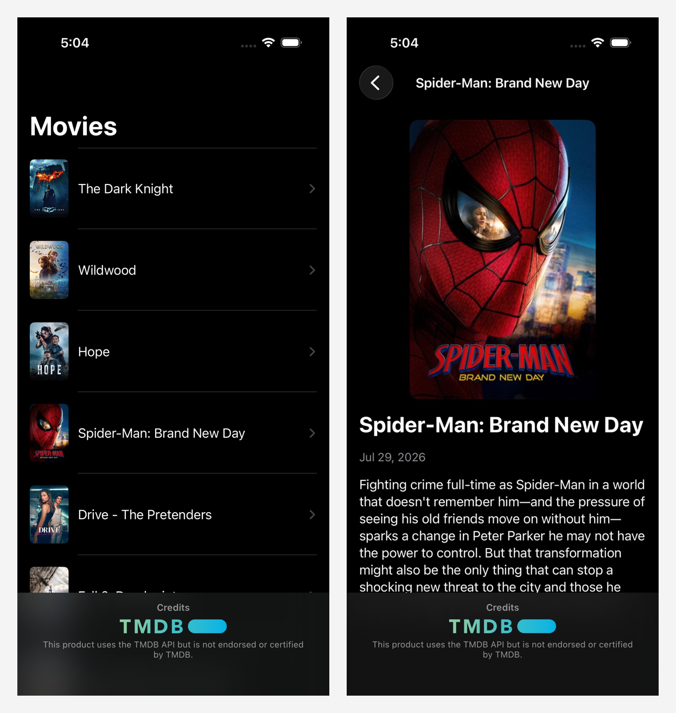
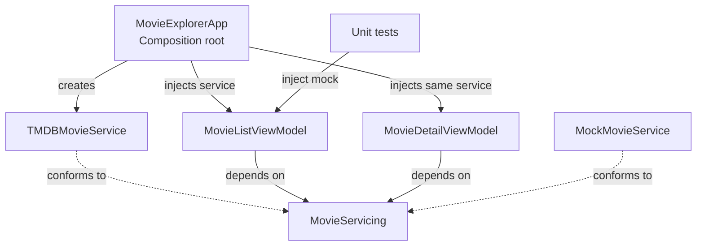
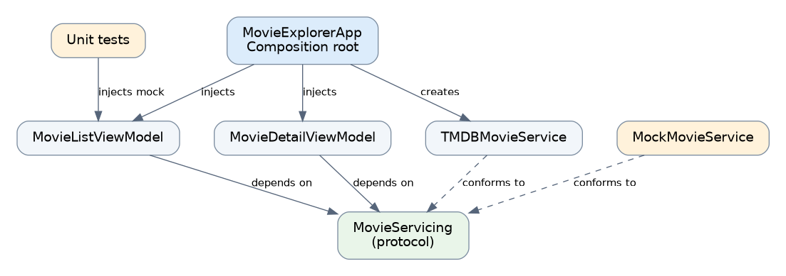

# Dependency Injection in Swift: A Practical Guide to Constructor Injection

*Part 1 — Constructor injection, explained through a two-screen SwiftUI app.*  
**Reading time: ~5 minutes**

## It works. Until you try to test it.



*MovieExplorer: Popular Movies and Movie Details, powered by TMDB.*

**[Explore the complete MovieExplorer source code on GitHub](https://github.com/premalmistry/MovieExplorer).**

Imagine a SwiftUI app with two screens: **Popular Movies** and **Movie Details**. Both fetch data from TMDB. The first implementation is tempting:

```swift
@MainActor
@Observable
final class MovieListViewModel {
    private let movieService: TMDBMovieService

    init() {
        movieService = TMDBMovieService(
            configuration: TMDBConfiguration.loadFromEnvironment()
        )
    }
}
```

The app runs. But now you want to preview the screen without an API token, test a failed request, or reuse the same service on the details screen.

The problem? **The view model chooses and creates its own dependency.** It has two jobs: assembling networking code and managing screen state. That is *tight coupling*.

## What is dependency injection?

A **dependency** is something an object needs to do its job. Here, the view model needs a movie service.

**Dependency injection (DI)** means giving an object that dependency from the outside instead of letting it create the dependency itself.

```swift
// Before: the view model decides what to create.
init() {
    movieService = TMDBMovieService(configuration: .loadFromEnvironment())
}

// After: the caller decides what to provide.
init(movieService: TMDBMovieService) {
    self.movieService = movieService
}
```

That's constructor injection. No library, container, or protocol required.

This is also an example of **inversion of control**: the caller now controls how the dependency is assembled. Don't confuse DI with the **Dependency Inversion Principle** (DIP). DI is about *supplying objects*; DIP is about *which abstractions high-level code depends on*. They often work together, but they're not the same thing.

## Three ways to inject a dependency

The difference is **when** you supply it.

| Approach | How it works | Good fit | Watch out for |
| --- | --- | --- | --- |
| **Constructor** | Pass it to `init` | Required, long-lived dependencies | Larger initializers |
| **Setter / property** | Assign it after initialization | Dependencies that arrive later | Object may be used before setup |
| **Method** | Pass it to a method | One-off operations | Repeated parameters |

A quick comparison:

```swift
// Constructor: ready as soon as it's created.
final class MovieBrowser {
    let client: MovieClient
    init(client: MovieClient) { self.client = client }
}

// Setter: can exist before it's configured.
final class MovieBrowserWithSetter {
    var client: MovieClient?
}

// Method: dependency is needed for just this call.
final class MovieBrowserWithMethod {
    func titles(using client: MovieClient) -> [String] {
        client.popularTitles()
    }
}
```

Here `MovieClient` is a small illustrative type with `popularTitles() -> [String]`. Our actual app uses an asynchronous TMDB service.

**Which should Movie Explorer use?** Constructor injection. Both screens need their movie service to work, and that service should be available from the moment each view model is created. Setter injection and method injection deserve their own articles.

## Step 1: Inject the service

We already moved `TMDBMovieService` into the initializer. That makes creation explicit, but tests still can't supply a lightweight fake: the initializer accepts only the concrete TMDB type.

Now we have a reason to introduce a protocol:

```swift
protocol MovieServicing: Sendable {
    func popularMovies() async throws -> [Movie]
    func movie(id: Int) async throws -> Movie
}
```

The production `TMDBMovieService` conforms to it. Our view model depends on the behavior it needs, not on TMDB specifically:

```swift
@MainActor
@Observable
final class MovieListViewModel {
    private(set) var movies: [Movie] = []
    private(set) var errorMessage: String?

    private let movieService: any MovieServicing

    init(movieService: any MovieServicing) {
        self.movieService = movieService
    }

    func load() async {
        do {
            movies = try await movieService.popularMovies()
            errorMessage = nil
        } catch {
            errorMessage = "Unable to load movies."
        }
    }
}
```

This abbreviated view model highlights DI; the companion project also handles loading state and cancellation. **The protocol didn't create dependency injection.** The initializer did. The protocol lets us substitute a different implementation.

## Step 2: Test without calling TMDB

A fake service can return exactly the data—or failure—we want to test:

```swift
struct MockMovieService: MovieServicing {
    let movies: [Movie]

    func popularMovies() async throws -> [Movie] { movies }
    func movie(id: Int) async throws -> Movie {
        guard let movie = movies.first(where: { $0.id == id }) else {
            throw MovieServiceError.invalidResponse
        }
        return movie
    }
}
```

Then a test injects the mock:

```swift
@MainActor
func testLoadPublishesMovies() async {
    let expected = MovieFixtures.paperPlanets
    let viewModel = MovieListViewModel(
        movieService: MockMovieService(movies: [expected])
    )

    await viewModel.load()

    XCTAssertEqual(viewModel.movies, [expected])
    XCTAssertNil(viewModel.errorMessage)
}
```

No API key. No network. No waiting for TMDB to respond. We can separately test failures using a mock that throws.

## Step 3: Who creates the real service?

If view models no longer create dependencies, **someone still must**. We call that place the *composition root*.

For our two-screen app, it's the SwiftUI `App`:

```swift
@main
@MainActor
struct MovieExplorerApp: App {
    private let movieService: TMDBMovieService
    private let listViewModel: MovieListViewModel

    init() {
        let service = TMDBMovieService(
            configuration: .loadFromEnvironment()
        )
        movieService = service
        listViewModel = MovieListViewModel(movieService: service)
    }

    var body: some Scene {
        WindowGroup {
            MovieListView(
                viewModel: listViewModel,
                makeDetailViewModel: { movieID in
                    MovieDetailViewModel(
                        movieID: movieID,
                        movieService: movieService
                    )
                }
            )
        }
    }
}
```

The app creates **one service** and passes it to both screens. Each view model focuses on screen behavior, not object construction.

Here's the dependency flow at a glance:





*Production uses TMDB; tests supply a mock through the same initializer. The Mermaid source is editable; the PNG can be used on publishing platforms that do not render Mermaid.*

## Do we need a DI container?

**Not yet.** A DI container is a tool that registers, creates, and sometimes shares dependencies. DI is the *technique*; a container is *optional machinery*.

For Movie Explorer, a few explicit initializer calls are easier to follow than a registry of registrations and lookups. A container may become useful when wiring a large dependency graph becomes a genuine maintenance problem.

A few rules worth keeping:

- **Inject required dependencies through initializers.** Avoid defaults that quietly construct production services.
- **Don't create a protocol for everything.** Introduce one when a meaningful alternative implementation is useful.
- **Don't hide dependencies behind global singletons.** Moving creation to the composition root makes choices visible.

## Takeaway

Constructor injection is a small change with an important consequence: **objects describe what they need; callers decide what to provide.**

Our Movie Explorer now has explicit dependencies, replaceable services, and unit tests that don't depend on the network—without a DI framework.

**[Explore the full implementation, including unit tests, on GitHub](https://github.com/premalmistry/MovieExplorer).**

**Coming next:** Part 2 explores setter injection—what happens when a dependency arrives *after* an object is created? In a later tutorial, we’ll build a small DI container and discuss when it’s worth using.

---

### References

- Martin Fowler — *Inversion of Control Containers and the Dependency Injection Pattern*
- Robert C. Martin — *The Dependency Inversion Principle*
- Kodeco — *Dependency Injection Tutorial for iOS: Getting Started*
- Apple — *Swift Sendable and Observation documentation*

*Movie data is provided by TMDB. This product uses the TMDB API but is not endorsed or certified by TMDB.*
